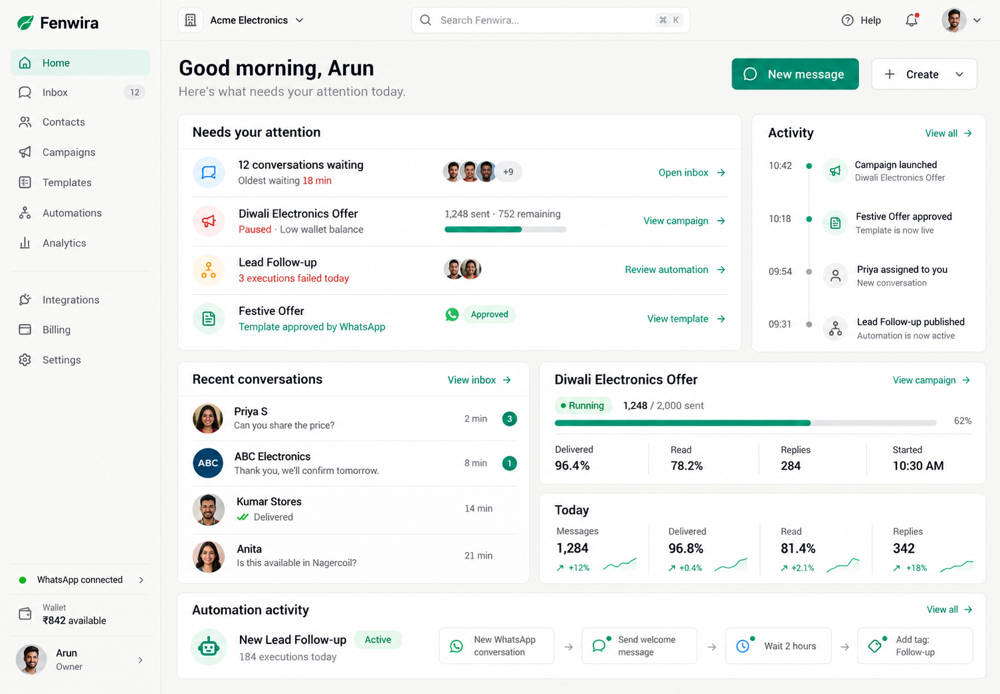
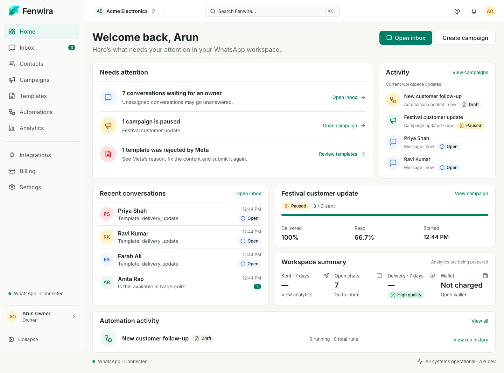
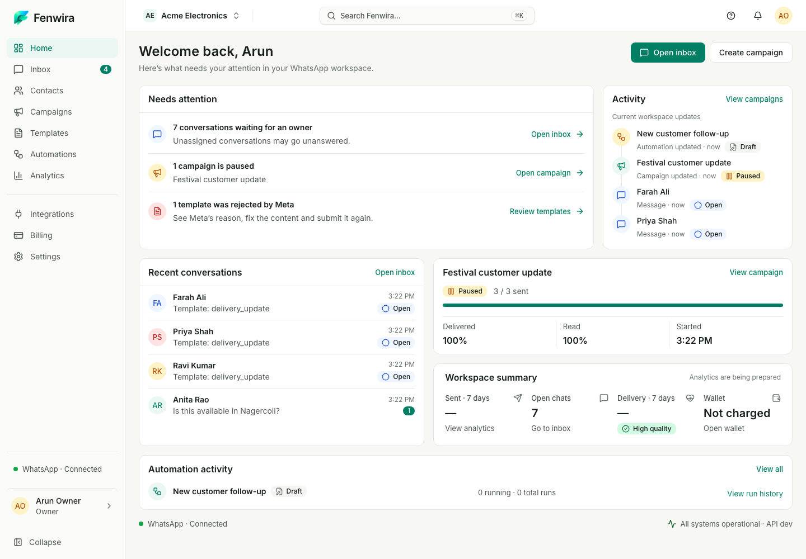

# Home scale refinement — ready for visual review

The user approved the Home direction in `408dfd0`. These captures refine only its geometry and the shell visible on Home. The original reference and approved reconstruction remain untouched. Local synthetic records are persisted through existing APIs and mock-provider responses; no screenshot records or counters are embedded in production presentation.

## Desktop comparison

| Original reference | Approved reconstruction (`408dfd0`) | Compact refinement |
| --- | --- | --- |
|  |  |  |

The attention/activity and conversation/campaign-summary bands preserve their proportions, purposeful tints, varied avatars and surface depth. Smaller navigation, headings, row objects and padding bring the full operational composition into the primary viewport. Band gaps and readable body text stay intact. [First compact iteration](iteration-1-1440.png) records the measurement-led pass before tightening timestamp spacing and update gaps.

## Responsive captures

All captures use a 1000px-high viewport and full-page screenshots. Smaller widths naturally scroll vertically.

| Viewport | Capture |
| --- | --- |
| 1440×1000 | [Home](home-1440.png) |
| 1024×1000 | [Home](home-1024.png) |
| 768×1000 | [Home](home-768.png) |
| 375×1000 | [Home](home-375.png) |

[Measured desktop geometry](home-geometry-1440.json) contains only dimensions and styles. [Scale changes and exact validation](../../../EXPERIENCE_V2_HOME_DENSITY.md) document the task. This refinement stops for user visual review before any propagation to Inbox or later modules.

Four-width Home Axe WCAG 2.2 AA: zero violations; zero page overflow. [Sanitized Lighthouse accessibility](accessibility.json): Home **100**, populated Inbox regression **100**, protected final URLs verified. No cookies, tokens, browser profiles or raw Lighthouse payloads are retained.
