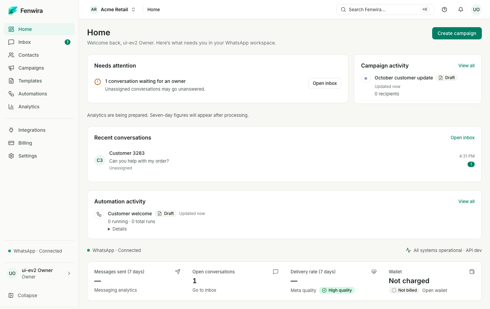
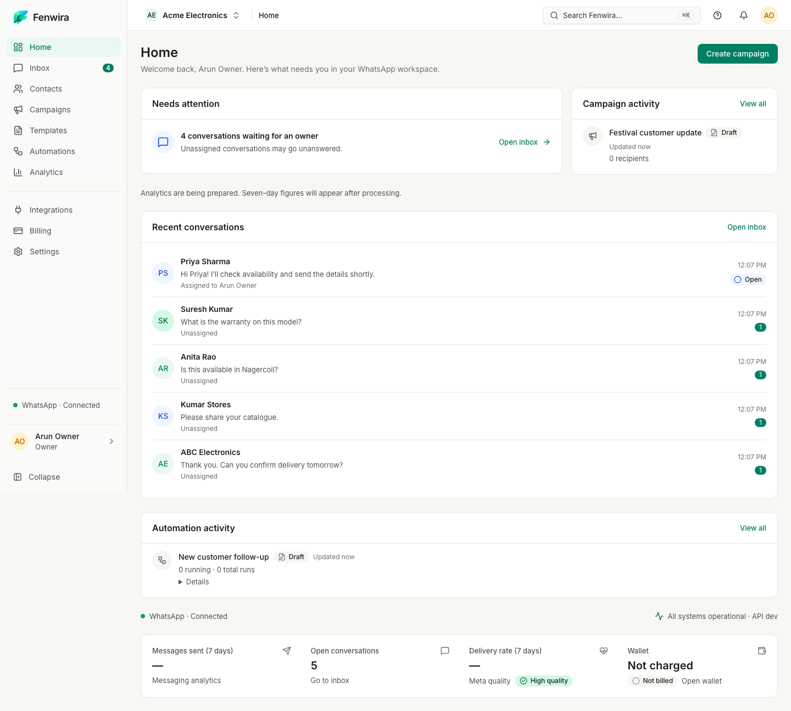

# Home reconstruction — ready for visual review

Review scope is Home and the shell visible on Home. Screenshots use a 1000px-high viewport and full-page capture. Test records are persisted through the local API and mock-provider import/webhooks, including actual campaign launch/delivery/pause and template rejection. No displayed metrics are embedded into production presentation.

## Side-by-side desktop review

| Approved reference | New reconstruction |
| --- | --- |
|  |  |

| Initial implementation | Previous fidelity correction |
| --- | --- |
|  |  |

## Responsive captures

| Viewport | Capture |
| --- | --- |
| 1440×1000 | [Home](home-1440.png) |
| 1024×1000 | [Home](home-1024.png) |
| 768×1000 | [Home](home-768.png) |
| 375×1000 | [Home](home-375.png) |

Internal comparisons: [first rebuilt grid](iteration-1-1440.png), [second composition/density iteration](iteration-2-1440.png), [third populated desktop](iteration-3-1440.png), [third mobile before action wrapping correction](iteration-3-375.png). Previous foundation/correction evidence remains untouched. The desktop and mobile captures show actual status and available data; differences from the concept, including canonical Paused labels and seven-day/unprocessed analytics, are deliberate data constraints.

See [decomposition, difference log and exact verification results](../../../EXPERIENCE_V2_HOME_RECONSTRUCTION.md). Visual approval belongs to the user; passing tests does not establish it.

Four-width Axe WCAG 2.2 AA: zero violations; zero page overflow. Authenticated [Lighthouse accessibility](accessibility.json): Home 100, protected final URL verified (Inbox remains a regression check only). Exact browser results: 62 passing cases from the 64-case aggregate, followed by 2 passing targeted reruns after updating obsolete Home presentation expectations. All 64 unique selected cases are covered. No assertion or navigation destination is dropped.
