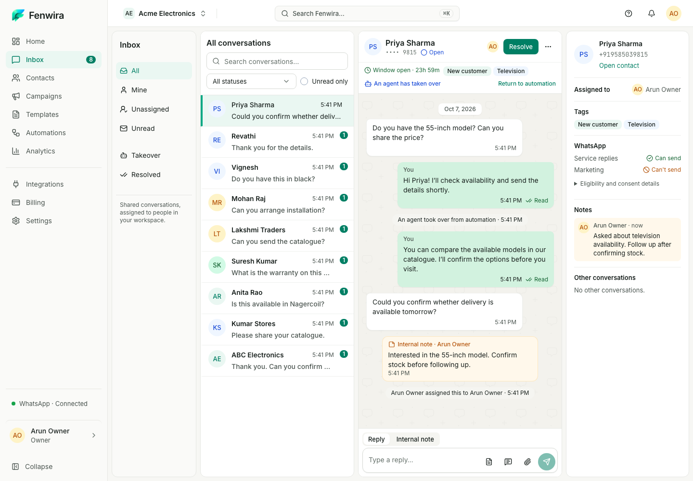
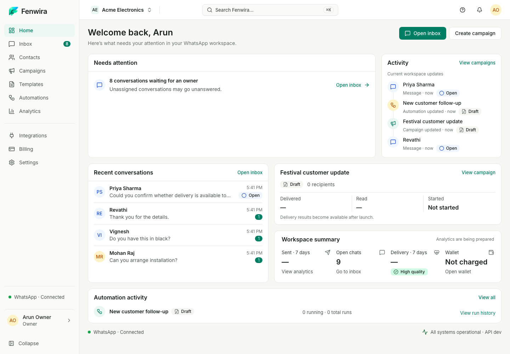

# Inbox final fidelity — Ready for visual review

The reconstruction is not visually approved. This pass preserves the approved Home shell, real capabilities and four-pane widths while correcting visual density and communication character. All screenshots use actual persisted synthetic local records and supported domain APIs/mock-provider events. No fake photos, counters or capabilities are embedded in the production UI.

## Reference and implementation history

| Approved composition reference | Previous reconstruction | Final fidelity |
| --- | --- | --- |
|  |  |  |

Every prior stage remains accessible: [original reference](../../02-Inbox.png), [previous implementation](../inbox-1440.png), [previous fidelity correction](../checkpoint-1-visual-fidelity/inbox-1440.png), [reconstruction](../inbox-reconstruction/inbox-1440.png), [final fidelity](inbox-1440.png). These historical folders are untouched.

## Home → Inbox consistency

| Approved Home language, recaptured | Inbox |
| --- | --- |
|  |  |

Home and its shell source are unchanged. Both use 224px navigation, 56px topbar, the same typography, controls, semantic palette and surface language. Inbox-only list avatars are 36px per the final-fidelity instruction; shared Avatar defaults remain unchanged. The outbound-only token is richer without changing Home or other modules.

## Responsive and operational review

| View / workflow | Capture |
| --- | --- |
| 1440×1000 | [Inbox](inbox-1440.png) |
| 1024×1000 | [Inbox; context in drawer](inbox-1024.png) |
| 768×1000 | [List and thread](inbox-768.png) |
| 375×1000 | [Conversation](inbox-375.png) |
| 375 list/back navigation | [Conversation list](inbox-list-375.png) |
| 375 full eligibility/consent | [Context drawer](inbox-context-375.png) |
| 1440 Internal note mode | [Private composer](inbox-note-1440.png) |
| 1440 writing at 160px cap | [Expanded composer](inbox-expanded-1440.png) |
| 1440 full server verdicts/consent | [Expanded context](inbox-eligibility-1440.png) |

[Final desktop geometry](inbox-geometry-1440.json), [expanded writing/composer geometry](inbox-expanded-geometry.json) and [Home shell geometry](home-geometry-1440.json) contain dimensions only. Standard/selected rows are 65px; primary header 64px, combined header 130px; resting composer 101px, writing 42px at rest/160px capped. Context identity is 68px and quiet WhatsApp section 121px. Pane widths remain 176/320/424/256.

## Deliberate cycles

[Cycle one desktop](cycle-1-1440.png), [cycle one mobile](cycle-1-375.png), [cycle one geometry](cycle-1-geometry.json); [cycle two desktop](cycle-2-1440.png), [cycle two mobile](cycle-2-375.png), [cycle two geometry](cycle-2-geometry.json). Each also retains 1024/768 images. Cycle one exposed mobile identity/placeholder wrapping; cycle two corrected those and tightened the mode selector. A final responsive screenshot review corrected the 1024 name truncation with a thread-width container query. Cycle images document intermediate states; use the final captures for review.

## Validation and boundary

Four-width populated Axe WCAG 2.2 AA, disclosure/drawer accessibility, contained scrolling, keyboard selection/disclosure, textarea growth/cap/shrink and mobile identity/40px targets are checked. Authenticated [Lighthouse accessibility](accessibility.json) records protected final URLs and Home 100 / Inbox 100, without raw reports, cookies or browser profiles.

See the [full report](../../../EXPERIENCE_V2_INBOX_FINAL_FIDELITY.md) for exact commands, before/after dimensions, two comparison cycles, final follow-up and testing limits. Engineering results do not establish visual approval. **Ready for visual review. Stop before later modules.**
