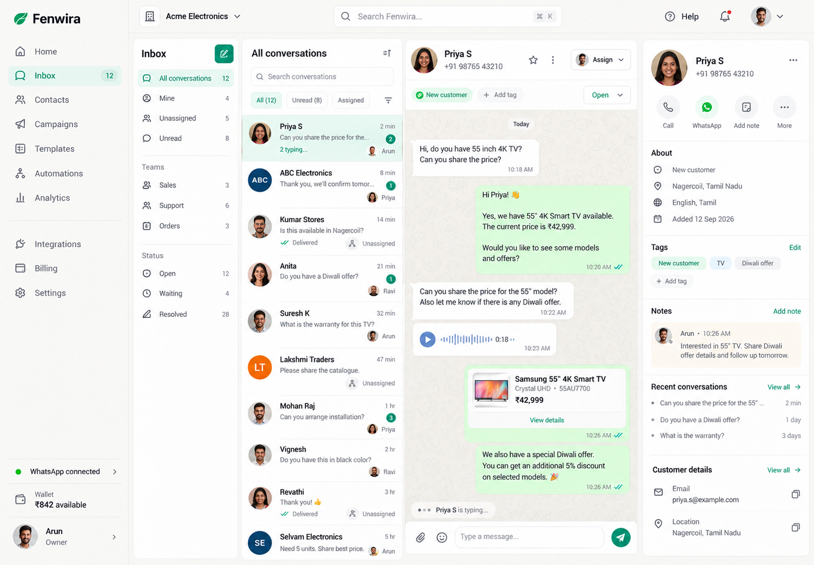
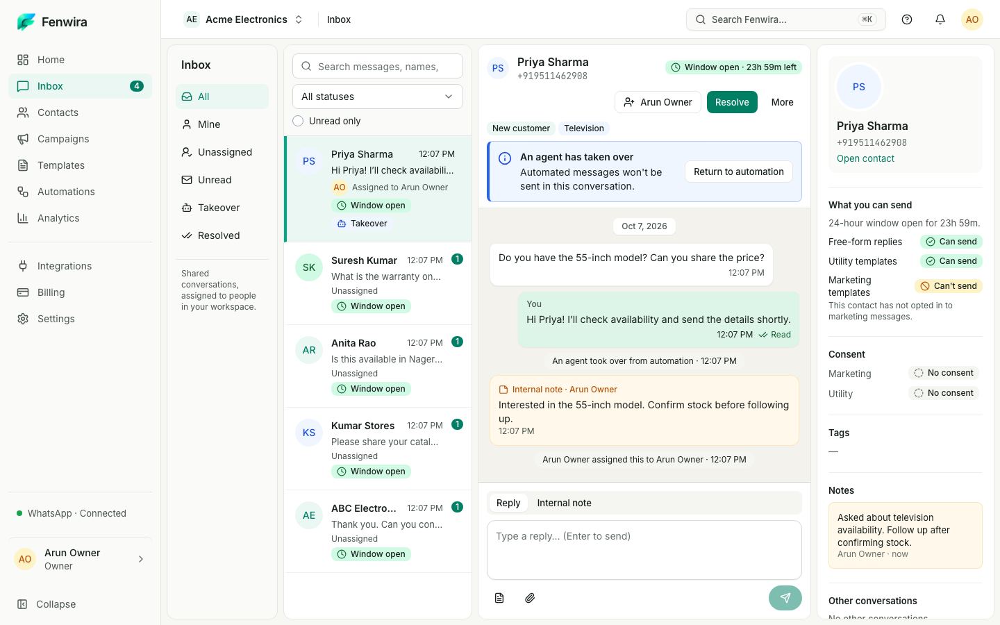
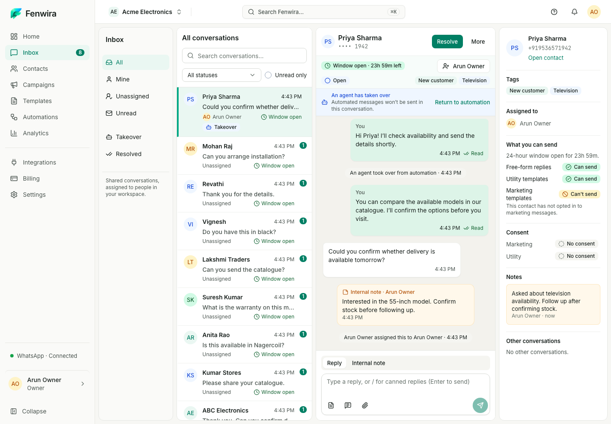
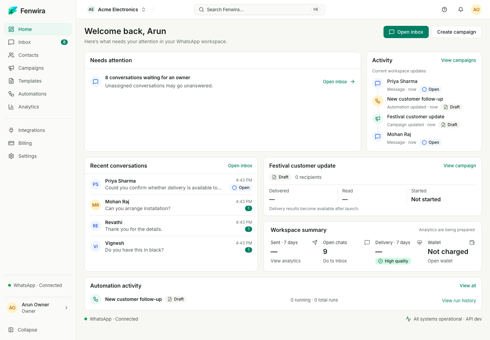

# Inbox reconstruction — ready for visual review

Scope: Inbox and reuse of the approved Home shell presentation. The final Home implementation remains unchanged. All captures use 1000px-high viewports and actual persisted synthetic local records, real replies/notes/assignment and mock-provider inbound/delivery events. No records, counters or unsupported capabilities are embedded into production UI.

## Desktop composition comparison

| Original Inbox reference | Previous fidelity correction | Final reconstruction |
| --- | --- | --- |
|  |  |  |

[Original implementation](../inbox-1440.png) also remains intact. The final Inbox has a calm view rail, human conversation rows, the largest flexible warm thread, emerald outgoing messages, explicitly private notes and lightweight context. Real service-window, delivery, individual assignment and eligibility states determine visible content. No team queues, ticketing, CRM, calls, AI, invented view counts or screenshot-only products/voice waveforms.

## Home consistency

| Canonical approved Home | Inbox with the same global language |
| --- | --- |
|  |  |

Home is recaptured with the same local workspace for comparison; its presentation source is untouched. Identical 224px global sidebar, 56px topbar, centered search, compact navigation, typography, palette, control scale and surface language. Inbox's composition follows the Inbox reference, with the thread as the center of work.

## Responsive and mode review

| Viewport / workflow | Capture |
| --- | --- |
| 1440×1000 | [Inbox](inbox-1440.png) |
| 1024×1000 | [Inbox](inbox-1024.png) |
| 768×1000 | [Inbox](inbox-768.png) |
| 375×1000 | [Thread](inbox-375.png) |
| 375 sequential navigation | [Conversation list](inbox-list-375.png) |
| 375 customer context | [Drawer](inbox-context-375.png) |
| 1440 private compose mode | [Internal note composer](inbox-note-1440.png) |

Visual iterations retained separately: [first desktop](iteration-1-1440.png), [first mobile](iteration-1-375.png), [second desktop](iteration-2-1440.png), [second mobile](iteration-2-375.png). Intermediate 1024/768 captures are also preserved. The second captures record the long-list document-height issue before the final containment fix; they are not final responsive evidence.

[Desktop geometry](inbox-geometry-1440.json) and [Home shell geometry](home-geometry-1440.json) contain dimensions only. Final populated captures pass Axe WCAG 2.2 AA at all four widths and in the mobile drawer, with no horizontal or document-height overflow. Authenticated [Lighthouse accessibility results](accessibility.json) are Home 100 / Inbox 100.

Validation covers 299 workspace unit tests, 10 Inbox integration tests and 61 distinct browser cases across the aggregate and corrected palette rerun, plus production Docker build and smoke. The exact commands, initial failures, reruns and limits are recorded in [reference decomposition, changes, visual differences and exact validation](../../../EXPERIENCE_V2_INBOX_RECONSTRUCTION.md). Engineering checks do not grant visual approval. Stop here for user visual review before Contacts or later modules.
